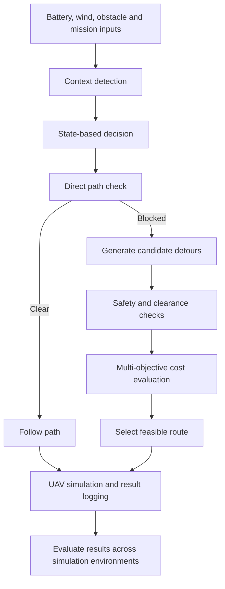

# Final Review Project Proposal (FRP)

## Course Details

- **Course:** 22AIE448 – Introduction to Data Driven Control of Drones
- **Batch:** AIE-CD
- **Team:** CD11

## Project Title

**Adaptive Context-Aware Multi-Objective Flight Decision Algorithm (ACMFDS)**

## Team Members

| S. No. | Name | Roll Number | Email |
|---:|---|---|---|
| 1 | Deepika Reddy | CB.SC.U4AIE24215 | [cb.sc.u4aie24215@cb.students.amrita.edu](mailto:cb.sc.u4aie24215@cb.students.amrita.edu) |
| 2 | Gade Varshini | CB.SC.U4AIE24216 | [cb.sc.u4aie24216@cb.students.amrita.edu](mailto:cb.sc.u4aie24216@cb.students.amrita.edu) |
| 3 | Jovika N B | CB.SC.U4AIE24223 | [cb.sc.u4aie24223@cb.students.amrita.edu](mailto:cb.sc.u4aie24223@cb.students.amrita.edu) |
| 4 | P Poojitha | CB.SC.U4AIE24237 | [cb.sc.u4aie24237@cb.students.amrita.edu](mailto:cb.sc.u4aie24237@cb.students.amrita.edu) |
| 5 | Potnuru Varun | CB.SC.U4AIE24244 | [cb.sc.u4aie24244@cb.students.amrita.edu](mailto:cb.sc.u4aie24244@cb.students.amrita.edu) |

## Proposed Project Work

- Develop a context-aware decision algorithm for a simulated UAV.
- Use battery level, wind speed, and obstacle distance to determine the flight context.
- Select suitable flight behaviour and candidate routes based on the current conditions.
- Evaluate feasible routes using a multi-objective cost function.
- Implement and demonstrate the project using **MATLAB simulation, Gym-PyBullet, and MuJoCo**.

## Problem Statement

- A UAV may need to change its behaviour when battery is low, wind is strong, or an obstacle is nearby.
- The project aims to make flight decisions based on the current context while considering safety, energy, time, and mission requirements.

## Objectives

- Detect the current flight context from the simulated inputs.
- Represent **Normal**, **HighWind**, **ObstacleAvoidance**, and **LowBattery** states using Stateflow.
- Generate and check alternative paths when the direct route is blocked.
- Select the lowest-cost route from the feasible candidates.
- Test and compare the algorithm in MATLAB, Gym-PyBullet, and MuJoCo simulations.

## Methodology

1. **Input:** Set battery level, wind speed, obstacle distance, and mission waypoints.
2. **Context detection:** Identify the current operating state.
3. **Decision making:** Generate the speed, mode, and action outputs for the current state.
4. **Path planning:** Check the direct path and generate detours if an obstacle blocks it.
5. **Safety check:** Reject candidate paths that violate the simulated obstacle-clearance constraint.
6. **Cost evaluation:** Calculate the cost of each feasible path and choose the lowest-cost option.
7. **Simulation:** Test the algorithm in MATLAB, Gym-PyBullet, and MuJoCo.
8. **Evaluation:** Compare the decisions and simulated flight behaviour under different conditions.

### Workflow

## Mathematical Formulation

The planner evaluates each candidate path using the weighted cost function

\[
J(P)=w_E E(P)+w_S S(P)+w_T T(P)+w_R R(P)+w_M M(P),
\]

where:

- \(P\): candidate path.
- \(E(P)\): energy-related cost.
- \(S(P)\): safety or obstacle-clearance cost.
- \(T(P)\): travel-time cost.
- \(R(P)\): tracking-deviation cost.
- \(M(P)\): mission-related cost.
- \(w_E,w_S,w_T,w_R,w_M\): weights assigned to the objectives.

The selected path is the feasible candidate with the lowest value of \(J(P)\).

The current MATLAB model uses the following minimum-clearance expression:

\[
d_{\mathrm{required}}=r_{\mathrm{UAV}}+b_{\mathrm{safety}}=2.5+1.0=3.5\ \mathrm{m}.
\]

## Tools and Technologies

| Tool | Purpose |
|---|---|
| MATLAB | UAV mission simulation, path planning, and result visualization |
| Simulink | Model integration, input knobs, and signal displays |
| Stateflow | Context states and decision outputs |
| Gym-PyBullet | UAV simulation and testing |
| MuJoCo | UAV simulation and testing |
| GitHub | Code management and documentation |

## Results and Evaluation

- Test the algorithm under different battery, wind, and obstacle conditions.
- Observe changes in context, decisions, and selected routes.
- Compare the simulated behaviour in MATLAB, Gym-PyBullet, and MuJoCo.
- Record relevant outputs and use the same test scenarios where comparison is possible.

## Expected Outcomes

- A context-aware UAV decision algorithm.
- State-based responses to changing simulated conditions.
- Obstacle-aware candidate path selection using a multi-objective cost function.
- Simulation results from MATLAB, Gym-PyBullet, and MuJoCo.

## Future Scope

- Improve coordination between the Simulink controls and MATLAB UAV simulation.
- Test with more realistic sensor, wind, and battery models.
- Extend path planning to three-dimensional environments.
- Evaluate the algorithm on a programmable physical drone, subject to hardware availability and approval.
