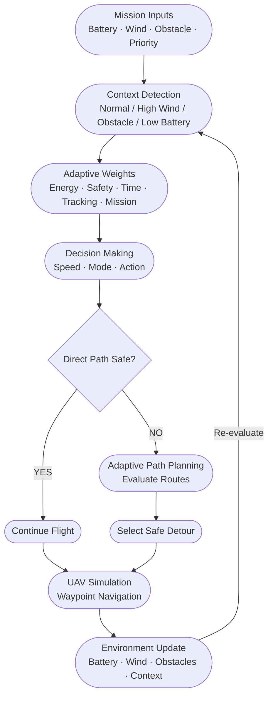
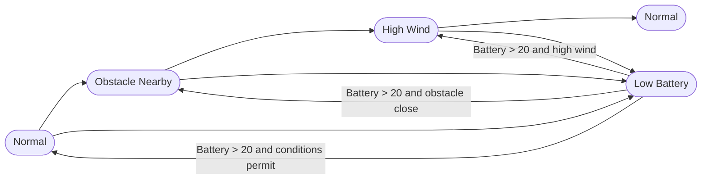
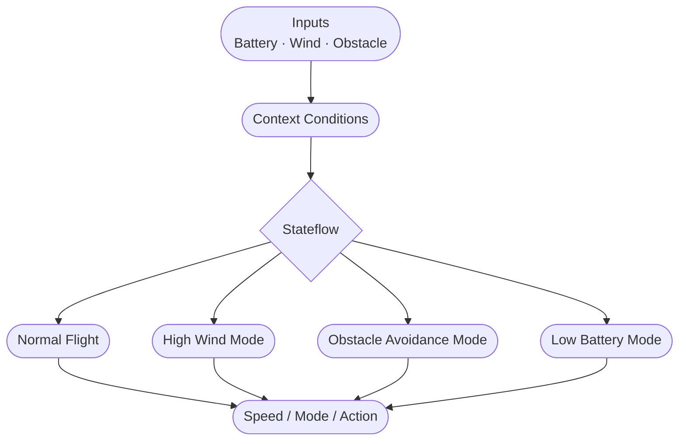

<h1>Adaptive Context-Aware Multi-Objective Flight Decision Algorithm (ACMFDS)</h1>

## Team Members

| S. No. | Name | Roll Number | Email |
|--------|------|-------------|-------|
| 1 | Deepika Reddy | cb.sc.u4aie24215 | [cb.sc.u4aie24215@cb.students.amrita.edu](mailto:cb.sc.u4aie24215@cb.students.amrita.edu) |
| 2 | Gade Varshini | cb.sc.u4aie24216 | [cb.sc.u4aie24216@cb.students.amrita.edu](mailto:cb.sc.u4aie24216@cb.students.amrita.edu) |
| 3 | Jovika N B | cb.sc.u4aie24223 | [cb.sc.u4aie24223@cb.students.amrita.edu](mailto:cb.sc.u4aie24223@cb.students.amrita.edu) |
| 4 | Poojitha P | cb.sc.u4aie24237 | [cb.sc.u4aie24237@cb.students.amrita.edu](mailto:cb.sc.u4aie24237@cb.students.amrita.edu) |
| 5 | Potnuru Varun | cb.sc.u4aie24244 | [cb.sc.u4aie24244@cb.students.amrita.edu](mailto:cb.sc.u4aie24244@cb.students.amrita.edu) |

## Abstract

This project develops an Adaptive Context-Aware Multi-Objective Flight Decision Algorithm (ACMFDS) for UAV mission simulation in changing environments. The MATLAB simulation evaluates battery level, wind speed, obstacle distance, and mission progress to select a context, decision weights, flight speed, mode, and action. When a direct route is blocked, the path planner evaluates candidate detours using distance, safety clearance, and a weighted cost, rejecting infeasible routes. The companion Simulink/Stateflow model represents Normal, HighWind, ObstacleAvoidance, and LowBattery behaviours. The repository also contains separate simulation work using Gym-PyBullet and MuJoCo; those environments should be run and evaluated separately from the MATLAB console simulation. The supplied MATLAB run records context changes, detour selection, waypoint progress, and mission completion. The shared run does not by itself demonstrate a LowBattery transition.


# Introduction

ACMFDS (Adaptive Context-Aware Multi-Objective Flight Decision Algorithm) is a simulation framework for context-aware UAV decision making. The MATLAB mission simulation uses battery level, wind speed, obstacle distance, and mission progress to choose the current context and adapt the UAV's speed, flight mode, and navigation action. The multi-objective cost uses five factors—Energy, Safety, Time, Tracking, and Mission—with context-dependent weights. In the shown Stateflow chart, the inputs are battery, wind speed, and obstacle distance; mission priority is computed separately by the MATLAB simulation from the remaining mission distance.

The overall decision cost is represented as:

$$C = \sum_{i=1}^{n} w_i f_i$$

| Symbol | Description |
|--------|-------------|
| **C** | Overall decision / path cost |
| $w_i$ | Importance (weight) assigned to factor $i$ |
| $f_i$ | Normalized cost/value of factor $i$ |

When the direct path is blocked, the planner evaluates alternative routes using distance, clearance, and cost, rejects unsafe routes, and selects a feasible detour.

The project integrates **MATLAB**, **Simulink**, and **Stateflow** to demonstrate context detection, adaptive decision-making, obstacle avoidance, dynamic path planning, waypoint navigation, changing environmental conditions, and successful mission completion.


## Methodology

### 1. Overall Methodology

The proposed Adaptive Context-Aware Multi-Objective Flight Decision Algorithm (ACMFDS) follows a closed-loop decision-making process. The UAV receives environmental and mission information such as battery level, wind speed, obstacle distance, and mission priority. These inputs are used to determine the current operating context.

Based on the detected context, ACMFDS selects appropriate decision weights, flight speed, operating mode, and action. If the direct path is safe, the UAV continues toward the waypoint. If an obstacle blocks the path, the adaptive planner evaluates possible detours based on distance, safety clearance, and cost. The selected path is then used by the UAV simulation, while changing environmental conditions can trigger a new decision.

### 2. Methodology Flow Diagram



### 3. Input and Environment Modeling

The main environmental inputs are battery level, wind speed, and obstacle distance in the Stateflow chart. The MATLAB mission simulation also computes mission priority from the remaining distance:

| Input | Purpose |
|-------|---------|
| Battery Level | Represents the available UAV energy |
| Wind Speed | Represents environmental disturbance |
| Obstacle Distance | Determines the level of navigation risk |
| Mission Priority (MATLAB simulation) | Represents how strongly the simulation prioritizes mission completion as the remaining distance decreases |

In the MATLAB script, mission priority is not a fixed constant throughout the mission. The logic shown in the existing simulation assigns 0.7 when the remaining distance is greater than 15 m, 0.9 when it is greater than 5 m and no greater than 15 m, and 1.0 when it is 5 m or less. If $d_r$ is the remaining distance, this rule is:

$$
p_M(d_r)=\begin{cases}
0.7, & d_r > 15,\\
0.9, & 5 < d_r \leq 15,\\
1.0, & d_r \leq 5.
\end{cases}
$$

The Stateflow chart shown in this repository does not have mission priority as a separate input. Battery, wind speed, and obstacle distance can be varied in the Stateflow model to test its four operating states.

### 4. Context Detection

The input conditions are interpreted by the decision system to determine the UAV's current context. Typical contexts used in the project include:

- **Normal** – Suitable environmental conditions.
- **Obstacle Nearby** – An obstacle requires increased safety consideration.
- **High Wind** – Strong wind requires safer flight behavior.
- **Low Battery** – Energy conservation becomes important.

The detected context determines which decision strategy and weights should be applied.

### 5. Adaptive Multi-Factor Decision Making

#### 5.1 Decision Factors

ACMFDS considers five major decision factors:

| Factor | Description |
|--------|-------------|
| **Energy** | Reduces unnecessary energy consumption |
| **Safety** | Prioritizes safe operation and obstacle clearance |
| **Time** | Considers the time required to complete the route |
| **Tracking** | Encourages the UAV to remain close to the desired route |
| **Mission** | Considers the importance of mission completion |

#### 5.2 Decision Cost Formula

The combined decision cost is represented as:

$$C = \sum_{i=1}^{n} w_i f_i$$

For this project, the expanded form is:

$$J_k = w_E E_k + w_S S_k + w_T T_k + w_R R_k + w_M M_k$$

| Symbol | Description |
|--------|-------------|
| $J_k$ | Total cost of candidate path $k$ |
| $E_k$ | Normalized energy cost of candidate path $k$ |
| $S_k$ | Normalized safety cost of candidate path $k$ |
| $T_k$ | Normalized travel-time cost of candidate path $k$ |
| $R_k$ | Normalized tracking-deviation cost of candidate path $k$ |
| $M_k$ | Normalized mission-related cost of candidate path $k$ |
| $w_E,w_S,w_T,w_R,w_M$ | Context-dependent weights for the five factors |

#### 5.3 Context-Dependent Weights

Not every factor is equally important in every situation. The weights are adapted based on the current context rather than remaining fixed:

| Context | Priority |
|---------|----------|
| **Normal** | Balance energy efficiency, route tracking, travel time, and mission progress |
| **Obstacle Nearby** | Give safety and obstacle clearance greater importance |
| **High Wind** | Give safety and stable navigation greater importance than minimizing travel time |
| **Low Battery** | Give energy conservation and safe completion greater importance than speed or unnecessary detours |

In the MATLAB mission simulation, mission priority is used as a separate scalar calculated from remaining distance; it is not a fifth Stateflow input and is distinct from the five objective weights. The LowBattery row above describes the intended context emphasis, while the Stateflow chart assigns the LowBattery state outputs `speed = 4`, `mode = 4`, and `action = 4`.

### 6. Adaptive Path Planning

After the decision stage, the system checks whether the direct path to the next waypoint is safe.

#### 6.1 Case 1 — Direct Path is Clear

The UAV follows the direct path toward the waypoint without any replanning.

#### 6.2 Case 2 — Direct Path is Blocked

The planner generates alternative routes in the following directions:

| Direction | Description |
|-----------|-------------|
| **East** | Alternative route to the east |
| **West** | Alternative route to the west |
| **North** | Alternative route to the north |
| **South** | Alternative route to the south |

Each candidate route is evaluated using its distance, obstacle clearance, and associated cost.

#### 6.3 Path Cost Formula

Each feasible candidate path $k$ is scored using the five normalized objective terms:

$$J_k = w_E E_k + w_S S_k + w_T T_k + w_R R_k + w_M M_k$$

The path distance itself is calculated from its successive waypoints:

$$D_k = \sum_{j=1}^{m-1} \left\|p_{j+1}-p_j\right\|_2$$

| Symbol | Description |
|--------|-------------|
| $D_k$ | Length of candidate path $k$ |
| $p_j$ | The $j$-th waypoint in a candidate path |
| $m$ | Number of waypoints in the candidate path |
| $J_k$ | Total weighted cost of candidate path $k$ |

#### 6.4 Route Selection

- Routes that do not satisfy the required safety clearance are considered **infeasible** and are **rejected**.
- The UAV selects the **lowest-cost feasible route** among the remaining candidates.

### 7. Obstacle Clearance and Safety

The system does not consider the UAV as a point. A vehicle radius and safety buffer are included when determining whether a route is safe.

The inflated safety margin is represented as:

$$d_{\mathrm{required}} = r_{\mathrm{UAV}} + b_{\mathrm{safety}}$$

| Symbol | Description |
|--------|-------------|
| $d_{\mathrm{required}}$ | Minimum required clearance distance |
| $r_{\mathrm{UAV}}$ | UAV / vehicle radius |
| $b_{\mathrm{safety}}$ | Additional safety buffer |

A candidate path is rejected when it enters the unsafe region around an obstacle. This allows the simulation to demonstrate realistic obstacle avoidance rather than simply checking whether the UAV's center crosses the obstacle.

### 8. Dynamic Context Update

One of the main features of ACMFDS is that the environment can change during the mission, and the system continuously re-evaluates its decisions accordingly.

#### Context Transition Example



#### What Gets Updated on Context Change?

| Parameter | Description |
|-----------|-------------|
| **Flight Mode** | Uses the mode assigned by the active Stateflow state (Normal, HighWind, ObstacleAvoidance, or LowBattery) |
| **UAV Speed** | Adjusted based on current risk level |
| **Decision Weights** | Re-prioritized according to the new context |
| **Navigation Action** | Flight behavior is updated accordingly |
| **Selected Path** | A new safe route is planned if required |

> **Key Principle:** The UAV does not need to complete the entire mission using the original decision. It continuously re-evaluates its behavior as conditions change, ensuring safe and efficient mission completion at all times.

### 9. Stateflow Implementation

The Stateflow component represents the UAV's behavioural logic. The chart shown has three inputs—`battery`, `windSpeed`, and `obstacleDistance`—and three outputs: `speed`, `mode`, and `action`. Its four states are Normal, HighWind, ObstacleAvoidance, and LowBattery. The battery threshold is 20: when `battery <= 20`, the chart transitions to LowBattery. The outgoing transitions from LowBattery are conditional on battery rising above 20 and on wind/obstacle conditions.

#### State Transition Flow



#### Operating States

| State | Trigger Condition | UAV Behavior |
|-------|------------------|--------------|
| **Normal** | `battery > 20`, `windSpeed < 10`, and `obstacleDistance > 5` | `speed = 10`, `mode = 1`, `action = 1` |
| **HighWind** | `battery > 20`, `windSpeed >= 10`, and `obstacleDistance > 5` | `speed = 7`, `mode = 2`, `action = 2` |
| **ObstacleAvoidance** | `battery > 20` and `obstacleDistance <= 5` | `speed = 5`, `mode = 3`, `action = 3` |
| **LowBattery** | `battery <= 20` | `speed = 4`, `mode = 4`, `action = 4` |

The chart's outgoing transitions from LowBattery allow the system to return to Normal, HighWind, or ObstacleAvoidance after the battery input rises above 20, depending on the wind and obstacle conditions. These are the state assignments visible in the shared chart.

> **Validation status:** The supplied MATLAB console log finishes with the mission completed and battery around 84.6%; it does not demonstrate a LowBattery transition. Test the Stateflow model with battery at or below 20 to verify that this state activates and outputs `speed = 4`, `mode = 4`, and `action = 4`.

### 10. MATLAB and Simulink Integration

The project uses MATLAB for the main UAV simulation and adaptive path-planning logic, while Simulink/Stateflow is used to represent and test the decision-making behavior.

| Component | Role |
|-----------|------|
| **MATLAB** | Main UAV simulation and adaptive path-planning logic |
| **Simulink** | System-level modeling and integration |
| **Stateflow** | Behavioral decision-making representation and testing |

The integration provides two related but distinct simulation views:

- **Stateflow:** tests state transitions and the `speed`, `mode`, and `action` outputs from battery, wind, and obstacle inputs.
- **MATLAB:** runs the waypoint-based mission simulation and adaptive path-planning logic.

The MATLAB simulation records information such as UAV position, battery level, wind conditions, obstacle distance, context, selected path, and mission progress. Changing a Simulink knob should not be described as changing the separate MATLAB trajectory unless the connection between the two simulations has been explicitly tested.

---

### 11. Mission Execution

The UAV moves through a sequence of mission waypoints. At each stage, the following process is followed:

````mermaid
flowchart TD
    A([1. Observe Battery, Wind and Obstacles])
    B([2. Determine Current Context])
    C([3. Apply Decision Weights])
    D([4. Select Speed, Mode and Action])
    E{5. Check Direct Path}
    F([6. Generate Detour if Necessary])
    G([7. Move Toward Waypoint])
    H([8. Update Environment and Battery])
    I{Mission Complete?}
    J([End Mission])
    K([LowBattery: speed 4, mode 4, action 4])

    A --> B --> C --> D --> E
    E -- Clear --> G
    E -- Blocked --> F --> G
    G --> H --> I
    I -- No --> A
    I -- Yes --> J
    B -->|Battery <= 20| K
    K --> G
````

> **Key Principle:** This creates a continuous adaptive decision loop rather than a one-time decision.

---

### 12. Simulation and Testing

The MATLAB and Stateflow components can be tested under different conditions by varying the following parameters. The recorded MATLAB test shown below covers obstacle and high-wind transitions; a separate low-battery run is needed to confirm the LowBattery state in the console/log output.

| Test Parameter | Description |
|----------------|-------------|
| **Battery Level** | Tests energy-aware decision making |
| **Wind Speed** | Tests safety mode activation |
| **Obstacle Distance / Count** | Tests path replanning and avoidance |
| **Mission Conditions** | Tests mission priority handling |

The resulting changes in UAV speed, operating mode, selected path, travel distance, and mission behaviour are observed and compared. The planner's logged examples show it selecting alternative paths when the direct path is blocked. LowBattery is present in the Stateflow chart, but it should be reported as validated only after a test with `battery <= 20` has been run and recorded.

---

### 13. Overall Methodology Summary

The complete ACMFDS methodology can be summarized as a continuous adaptive loop:

````mermaid
flowchart LR
    A([Sense]) --> B([Identify Context]) --> C([Assign Weights]) --> D([Make Decision]) --> E([Check Path]) --> F([Avoid Obstacles]) --> G([Fly]) --> H([Update Environment]) --> A
````

This enables the UAV to adapt its behavior according to changing environmental and mission conditions while balancing:

| Factor | Role |
|--------|------|
| **Safety** | Avoid obstacles and unsafe conditions |
| **Energy** | Conserve battery for mission completion |
| **Time** | Minimize unnecessary delays |
| **Tracking** | Stay close to the planned route |
| **Mission** | Ensure successful mission completion |

# Results

## Simulation Results

The MATLAB simulation was evaluated under changing environmental conditions. The supplied console log records obstacle-related replanning, a High Wind context, return to Normal context, waypoint progress, and mission completion. The Stateflow chart separately defines the LowBattery state; the supplied MATLAB run does not demonstrate that transition.

The supplied run provides evidence for:

- Context changes involving Normal, Obstacle Nearby, and High Wind
- Alternative-route evaluation when the direct path is blocked
- Rejection of candidate routes reported as infeasible
- Selection of speed, mode, and action outputs for the logged contexts
- Waypoint progress and mission completion
- A separate LowBattery threshold test remains necessary.

---

## Test Case 1 – Dynamic Context Switching

The supplied MATLAB console log records context changes during mission execution. The initial printed context is `Obstacle Nearby`; the later log entries show a context update to Normal at 0.00 s, Obstacle Nearby at 1.50 s, High Wind at 3.60 s, and Normal at 6.00 s. This distinction is included because the initial summary and first context-update message are not identical.

| Parameter | Observation |
|-----------|-------------|
| Initial printed context | Obstacle Nearby |
| Recorded context updates | Normal (0.00 s) → Obstacle Nearby (1.50 s) → High Wind (3.60 s) → Normal (6.00 s) |
| Waypoint progress | Waypoints 2, 3, 4, and 5 reported reached after planning steps |
| Simulation time | 11.40 s |
| Final battery | 84.59% (from the supplied log) |
| Mission status | Completed in the supplied MATLAB run |
| LowBattery state | Not demonstrated by this run |

### Observations

- The MATLAB decision output changed with the logged context: obstacle avoidance at 5.0 m/s, Safety Mode at 7.0 m/s during high wind, and Normal Flight at 10.0 m/s when conditions returned to Normal.
- When the direct path was blocked, the planner scored candidate detours and selected a feasible route in the recorded snapshots.
- The log reports waypoint progress and mission completion.
- This run does not test the Stateflow LowBattery state because the logged battery remains above the 20% threshold.

---

## Test Case 2 – Adaptive Path Planning

The planner evaluates multiple candidate routes whenever the direct path is blocked.

One logged planner snapshot reported the following candidate results:

| Route | Distance | Clearance | Cost / status |
|--------|----------|-----------|---------------|
| East | 35.00 m | 4.50 m | 0.526; selected |
| West | 35.00 m | 4.50 m | 0.526; feasible alternative |
| North | 20.00 m | 0.00 m | Infeasible (`Inf`) |
| South | 20.00 m | 0.00 m | Infeasible (`Inf`) |

This is one snapshot from the supplied log; the selected direction can change as the current position and context change. The planner chooses the minimum-cost candidate among the feasible routes.

---

## Test Case 3 – Context Transition

During the supplied run, the MATLAB simulation reported changes involving Normal, Obstacle Nearby, and High Wind contexts.


The LowBattery state is present in the Stateflow chart, but it is not part of the context sequence captured in this MATLAB run.

---

## Test Case 4 – Mission Completion

The supplied MATLAB simulation log reached its mission-completion summary. This is a simulation result and not evidence of physical flight testing.

| Metric | Result |
|---------|--------|
| Mission Status | Success |
| Final Context | Normal |
| Final position reported | `[0.00 0.00 -10.00]` |
| Battery remaining | 84.59% |
| Simulation time | 11.40 s |
| Recorded samples | 114 |
| Waypoint progress | Waypoints 2–5 reported reached in the log |

---

## Performance Comparison

The following table compares the implemented capabilities with a fixed, non-adaptive planning baseline conceptually. A separate experimental baseline was not included in the supplied logs, so this is a feature comparison rather than a measured performance benchmark.

| Feature | Fixed-planning baseline (conceptual) | ACMFDS implementation |
|-----------|-------------------------------------|-----------------------|
| Context awareness | Not assumed | Implemented in MATLAB/Stateflow |
| Context-dependent decisions | Fixed rules assumed | Implemented |
| Adaptive multi-factor weights | Not assumed | Implemented in MATLAB simulation |
| Obstacle replanning | Not assumed | Implemented in MATLAB path planner |
| Stateflow integration | Not assumed | Implemented |
| LowBattery state | Not assumed | State defined in chart; separate threshold test required |
| Quantitative baseline comparison | Not available | Not measured in the supplied logs |

---

## Result Summary

The supplied simulation log shows that ACMFDS:

- Reports changing operating contexts.
- Selects different speed/mode/action outputs for logged contexts.
- Evaluates alternative routes when a direct path is blocked.
- Rejects candidate routes reported as infeasible (`Inf` cost).
- Reports progress through the waypoint sequence and mission completion.
- Still requires a separate recorded test to demonstrate the Stateflow LowBattery transition at `battery <= 20`.

---

# Project Files

The GitHub folder shown in the repository screenshot is `Matlab+ Simulink/`. The following entries are visible in that folder:

| File | Purpose |
|------|---------|
| `ACMFDS_Stateflow.slx` | Simulink model containing the Stateflow decision chart |
| `ACMFDS_MissionData.mat` | Saved mission data |
| `MultiObjectiveResults.mat` | Saved multi-objective experiment results |
| `MultiObjectiveResults.xlsx` | Spreadsheet export of experiment results |
| `acmfds_uav_v2.m` | Main MATLAB UAV mission simulation |
| `adaptivePathPlanner.m` | Adaptive path-planning function |
| `contextManager.m` | Context-management function |
| `decisionManager.m` | Decision-selection function |
| `detectContext.m` | Context-detection function |
| `dynamicContext.m` | Dynamic-context function |
| `multiObstacleExperiment.m` | Multiple-obstacle experiment script |
| `multiObstaclePlanner.m` | Multi-obstacle planning function |
| `obstacleCountExperiment.m` | Obstacle-count experiment script |
| `README.md` | Documentation for the MATLAB/Simulink folder |

The repository also contains separate `Matlab Simulation/` and `Mujoco/` folders, along with team-member folders.


# Conclusion

This project presents ACMFDS as a simulation framework combining context detection, multi-objective decision making, Stateflow state logic, and MATLAB adaptive path planning. The recorded MATLAB run demonstrates changes between Normal, Obstacle Nearby, and High Wind contexts, candidate-route evaluation, waypoint progress, and mission completion. The Stateflow chart also includes a LowBattery state with `battery <= 20` and outputs `speed = 4`, `mode = 4`, and `action = 4`; this state must be confirmed with a dedicated low-battery test before it is described as demonstrated in the recorded MATLAB results. The MATLAB script computes mission priority from remaining distance, whereas the shown Stateflow chart receives battery, wind speed, and obstacle distance as inputs. The repository also contains separate Gym-PyBullet and MuJoCo simulation work, which should be described and evaluated separately from the MATLAB run.

---

# Future Scope

Several enhancements can be incorporated into the proposed framework.

- Integration with real UAV hardware.
- Real-time GPS based navigation.
- Vision-based obstacle detection.
- Deep Learning based context prediction.
- Reinforcement Learning for adaptive policy optimization.
- Multi-UAV cooperative mission planning.
- Dynamic weather forecasting integration.
- 3D terrain-aware path planning.
- Real-time onboard implementation using embedded systems.

---

# References

1. Base Research Paper (Provided for the Project)

2. MathWorks — MATLAB

https://www.mathworks.com/products/matlab.html

3. MathWorks — Simulink

https://www.mathworks.com/products/simulink.html

4. MathWorks — Stateflow

https://www.mathworks.com/products/stateflow.html

5. LaValle, S. M.

Planning Algorithms.

https://planning.cs.uiuc.edu/

6. Sebastian Thrun, Wolfram Burgard, Dieter Fox.

Probabilistic Robotics.

https://mitpress.mit.edu/9780262201629/probabilistic-robotics/

7. Aggarwal, S., and Kumar, N. “Path planning techniques for unmanned aerial vehicles: A review, solutions, and challenges.” *Computer Communications*, vol. 149, pp. 270–299, 2020.

https://doi.org/10.1016/j.comcom.2019.10.014

8. Hu, X., et al. “Advances in UAV Path Planning: A Comprehensive Review of Methods, Challenges, and Future Directions.” *Drones*, vol. 9, no. 5, article 376, 2025.

https://doi.org/10.3390/drones9050376

9. Kumar, P., Pal, K., and Govil, M. C. “Comprehensive Review of Path Planning Techniques for Unmanned Aerial Vehicles (UAVs).” *ACM Computing Surveys*, vol. 58, no. 3, article 73, 2025.

https://doi.org/10.1145/3737280

---

# Repository Structure

The structure below reflects the project folders and the contents of `Matlab+ Simulink/` visible in the supplied GitHub screenshot. Team-member folders are also present at the repository root; they are omitted from this project-folder view. The contents of `Matlab Simulation/` and `Mujoco/` are not expanded because their full file lists are not visible in the screenshot.

```text
Drones_S5_CD11_Adaptive_Context_Aware_Decision/
├── README.md
├── Matlab Simulation/
├── Matlab+ Simulink/
│   ├── ACMFDS_Stateflow.slx
│   ├── ACMFDS_MissionData.mat
│   ├── MultiObjectiveResults.mat
│   ├── MultiObjectiveResults.xlsx
│   ├── README.md
│   ├── acmfds_uav_v2.m
│   ├── adaptivePathPlanner.m
│   ├── contextManager.m
│   ├── decisionManager.m
│   ├── detectContext.m
│   ├── dynamicContext.m
│   ├── multiObstacleExperiment.m
│   ├── multiObstaclePlanner.m
│   └── obstacleCountExperiment.m
└── Mujoco/
```


# Software Requirements

| Software | Version |
|-----------|----------|
| MATLAB | R2023a or later (the development screenshots show R2024a) |
| Simulink | Required for the `.slx` model |
| Stateflow | Required to run/edit the Stateflow chart |

The MATLAB/Simulink folder does not require a Python package installation for the `.m` and `.slx` files. Gym-PyBullet and MuJoCo are separate subprojects and may have their own Python environments and package requirements; use the installation instructions in those folders if they are supplied.

---

# How to Run

1. Open MATLAB and set the Current Folder to `Matlab+ Simulink`.

2. Keep the MATLAB helper files, data files, and experiment scripts together in this folder so the main script can find them.

3. Open the Stateflow model:

```text
ACMFDS_Stateflow.slx
```

4. Run the main MATLAB mission simulation from the Command Window:

```matlab
acmfds_uav_v2
```

5. Run the experiment scripts separately when required:

```matlab
multiObstacleExperiment
```

```matlab
obstacleCountExperiment
```

6. For the LowBattery test, set the Stateflow `BatteryKnob` input to a value at or below 20, run the model, and verify the LowBattery state and its `speed`, `mode`, and `action` outputs. This test should be recorded separately from the current MATLAB log.

7. To test whether changing Simulink knobs also changes the MATLAB UAV trajectory, verify the signal/data connection between the model and MATLAB script; the two outputs should not be assumed to be linked solely because the Stateflow displays update.

---

# Acknowledgement

The authors sincerely thank **Amrita Vishwa Vidyapeetham**, the Department of Artificial Intelligence, and the faculty members for their continuous guidance and support throughout the development of this project....
