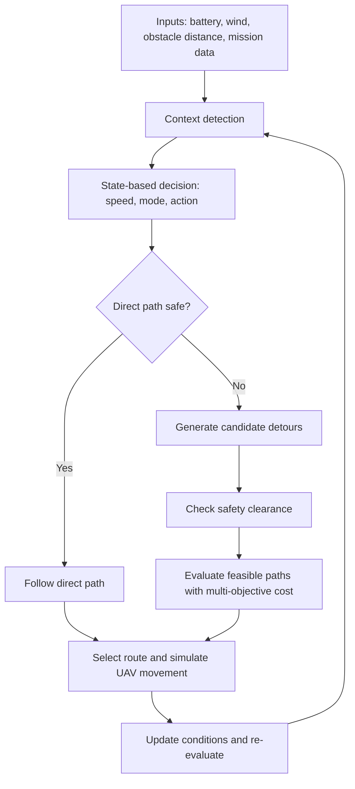

# Adaptive Context-Aware Multi-Objective Flight Decision Algorithm (ACMFDS)

**Course:** 22AIE448 – Introduction to Data Driven Control of Drones  
**Batch:** AIE-CD  
**Team:** CD11

## Team Members

| S. No. | Name | Roll Number | Email |
|---:|---|---|---|
| 1 | Deepika Reddy | CB.SC.U4AIE24215 | [cb.sc.u4aie24215@cb.students.amrita.edu](mailto:cb.sc.u4aie24215@cb.students.amrita.edu) |
| 2 | Gade Varshini | CB.SC.U4AIE24216 | [cb.sc.u4aie24216@cb.students.amrita.edu](mailto:cb.sc.u4aie24216@cb.students.amrita.edu) |
| 3 | Jovika N B | CB.SC.U4AIE24223 | [cb.sc.u4aie24223@cb.students.amrita.edu](mailto:cb.sc.u4aie24223@cb.students.amrita.edu) |
| 4 | P Poojitha | CB.SC.U4AIE24237 | [cb.sc.u4aie24237@cb.students.amrita.edu](mailto:cb.sc.u4aie24237@cb.students.amrita.edu) |
| 5 | Potnuru Varun | CB.SC.U4AIE24244 | [cb.sc.u4aie24244@cb.students.amrita.edu](mailto:cb.sc.u4aie24244@cb.students.amrita.edu) |

## Abstract

ACMFDS is a context-aware UAV decision and path-planning project. It uses conditions such as battery level, wind speed, obstacle distance, and mission progress to select flight behaviour. In the MATLAB/Simulink implementation, Stateflow represents the **Normal**, **HighWind**, **ObstacleAvoidance**, and **LowBattery** states. The MATLAB planner checks the direct route, evaluates candidate detours when needed, rejects unsafe paths, and selects a feasible low-cost route. The repository also contains separate Gym-PyBullet and MuJoCo simulation work used by the team for project evaluation.

## Problem Statement

- A UAV may need to change its behaviour when battery is low, wind is strong, or an obstacle is nearby.
- A fixed route may become unsafe when conditions change during a mission.
- The goal is to make context-aware flight decisions while balancing safety, energy, time, tracking, and mission requirements.

## Objectives

- Detect the simulated UAV's operating context.
- Use Stateflow to represent the four behavioural states.
- Adjust speed, mode, and action according to the active state.
- Check the direct path and consider alternative paths when it is blocked.
- Score candidate paths using a multi-objective cost function and reject unsafe candidates.
- Demonstrate and evaluate the project in MATLAB/Simulink, Gym-PyBullet, and MuJoCo simulation environments.

## System Workflow



## Mathematical Formulation

For a candidate path $P$, the weighted objective is represented as

$$
J(P) = w_E E(P) + w_S S(P) + w_T T(P) + w_R R(P) + w_M M(P),
$$

where:

- $E(P)$: energy-related cost.
- $S(P)$: safety or obstacle-clearance cost.
- $T(P)$: travel-time cost.
- $R(P)$: tracking-deviation cost.
- $M(P)$: mission-related cost.
- $w_E, w_S, w_T, w_R, w_M$: context-dependent objective weights.

Among the feasible candidates, the planner selects the path with the lowest objective value:

$$
P^* = \underset{P \in \mathcal{P}_{\mathrm{feasible}}}{\arg\min}\ J(P).
$$

The MATLAB planner uses an obstacle-clearance requirement based on the UAV radius and an additional safety buffer:

$$
d_{\mathrm{required}} = r_{\mathrm{UAV}} + b_{\mathrm{safety}}.
$$

For the parameters used in the shared MATLAB planner, $r_{\mathrm{UAV}} = 2.5\text{ m}$ and $b_{\mathrm{safety}} = 1.0\text{ m}$, so $d_{\mathrm{required}} = 3.5\text{ m}$.

## Contexts and Stateflow Logic

| State | Condition represented in the model | State outputs shown in the chart |
|---|---|---|
| **Normal** | Battery above 20%, wind below 10 m/s, and obstacle distance above 5 m | Speed = 10, mode = 1, action = 1 |
| **HighWind** | Wind speed at least 10 m/s, with battery above 20% and obstacle distance above 5 m | Speed = 7, mode = 2, action = 2 |
| **ObstacleAvoidance** | Obstacle distance at or below 5 m, with battery above 20% | Speed = 5, mode = 3, action = 3 |
| **LowBattery** | Battery at or below 20% | Speed = 4, mode = 4, action = 4 |

These numeric outputs are the encodings used by the current Stateflow chart. They are not universal UAV control values. Once battery rises above the low-battery threshold, the outgoing transition conditions select the relevant context based on wind and obstacle inputs.

**Mission priority:** In the shared MATLAB implementation, mission priority is calculated separately from the remaining distance to the mission goal. It is not shown as an input to the Stateflow chart. Do not interpret it as an independently adjustable Stateflow knob unless the model is changed to include that input.

## Simulation Environments

| Folder | Purpose |
|---|---|
| [`Matlab+ Simulink`](<Matlab+ Simulink/README.md>) | MATLAB UAV simulation, adaptive path planning, Simulink/Stateflow model, and associated results. |
| [`Matlab Simulation`](<Matlab Simulation/README.md>) | Separate MATLAB simulation work. Check the folder's own README for its entry script and usage. |
| [`gym-pybullet`](<gym-pybullet/README.md>) | Gym-PyBullet implementation and its environment-specific instructions. |
| [`Mujoco`](<Mujoco/README.md>) | MuJoCo implementation and its environment-specific instructions. |

## Recorded MATLAB Simulation Result

One shared MATLAB console run reported the following values:

| Metric | Recorded value |
|---|---:|
| Initial battery | 85.00% |
| Wind at start | 4.0 m/s |
| Recorded context sequence | Normal / Obstacle Nearby / High Wind / Normal during the run |
| Waypoints reached | 5 |
| Final battery | 84.59% |
| Simulation time | 11.40 s |
| Mission status reported by the script | Mission complete |


## Installation and Execution

### MATLAB / Simulink / Stateflow

- MATLAB R2023a or later is listed in the project's MATLAB documentation requirements.
- Simulink and Stateflow are required for the `.slx` model.
- Open `Matlab+ Simulink/ACMFDS_Stateflow.slx` in MATLAB to inspect or run the Stateflow model.
- Set the MATLAB Current Folder to `Matlab+ Simulink` before running its main script or experiments, so helper functions and data files can be found.
- Follow the instructions in [`Matlab+ Simulink/README.md`](<Matlab+ Simulink/README.md>) for the exact script names and experiment commands.

### Python simulation folders

Use Python 3.10 or a compatible version supported by the scripts. A virtual environment is recommended.

```bash
python -m venv .venv
```

Activate it on Windows:

```powershell
.venv\Scripts\activate
```

Upgrade `pip` and install commonly used numerical, plotting, and simulation packages:

```bash
python -m pip install --upgrade pip
python -m pip install numpy scipy matplotlib gymnasium pybullet mujoco
```

Run the Gym-PyBullet or MuJoCo code from its own folder and follow the local README or requirements file if it specifies additional or different dependencies. The exact entry-point script depends on the files in that folder.

## Repository Contents

```text
.
├── Matlab Simulation/
├── Matlab+ Simulink/
│   ├── ACMFDS_Stateflow.slx
│   ├── ACMFDS_MissionData.mat
│   ├── acmfds_uav_v2.m
│   ├── adaptivePathPlanner.m
│   ├── contextManager.m
│   ├── decisionManager.m
│   ├── detectContext.m
│   ├── dynamicContext.m
│   ├── multiObstacleExperiment.m
│   ├── multiObstaclePlanner.m
│   ├── obstacleCountExperiment.m
│   ├── MultiObjectiveResults.mat
│   ├── MultiObjectiveResults.xlsx
│   └── README.md
├── gym-pybullet/
├── Mujoco/
├── ACMFDS_Project_Presentation.pptx
├── FRP.md
├── logo-branding-amrita-universiy-2024.jpg
└── README.md
```

The tree lists the primary files visible in the repository screenshots. Other helper scripts may be present in the MATLAB folder and should be retained if referenced by an experiment or the main script.

## Project Presentation and Proposal

- [`ACMFDS_Project_Presentation.pptx`](./ACMFDS_Project_Presentation.pptx) — final-review presentation.
- [`FRP.md`](./FRP.md) — Final Review Project proposal.
- Each simulation folder has its own README for implementation-specific details.

## Conclusion

ACMFDS explores context-aware UAV decision-making through simulated battery, wind, and obstacle conditions. The MATLAB/Simulink component combines Stateflow behavioural states with multi-objective path planning. Gym-PyBullet and MuJoCo provide additional simulation environments maintained by the team. The current recorded MATLAB run demonstrates changing contexts, detour selection, waypoint progress, and mission completion; LowBattery behaviour should be demonstrated with a dedicated threshold test.

## References

1. S. M. LaValle, *Planning Algorithms*. Cambridge University Press, 2006. [Author's online book](https://lavalle.pl/planning/).
2. S. Thrun, W. Burgard, and D. Fox, *Probabilistic Robotics*. MIT Press, 2005. [MIT Press](https://mitpress.mit.edu/9780262201629/probabilistic-robotics/).
3. MathWorks, [MATLAB](https://www.mathworks.com/products/matlab.html), [Simulink](https://www.mathworks.com/products/simulink.html), and [Stateflow](https://www.mathworks.com/products/stateflow.html) product documentation.
4. Gymnasium documentation. [https://gymnasium.farama.org/](https://gymnasium.farama.org/).
5. PyBullet repository and documentation. [https://github.com/bulletphysics/bullet3](https://github.com/bulletphysics/bullet3).
6. MuJoCo documentation. [https://mujoco.org/](https://mujoco.org/).

## Acknowledgement

The team thanks Amrita Vishwa Vidyapeetham, the Department of Artificial Intelligence, and the course faculty for their guidance and support throughout the project.
