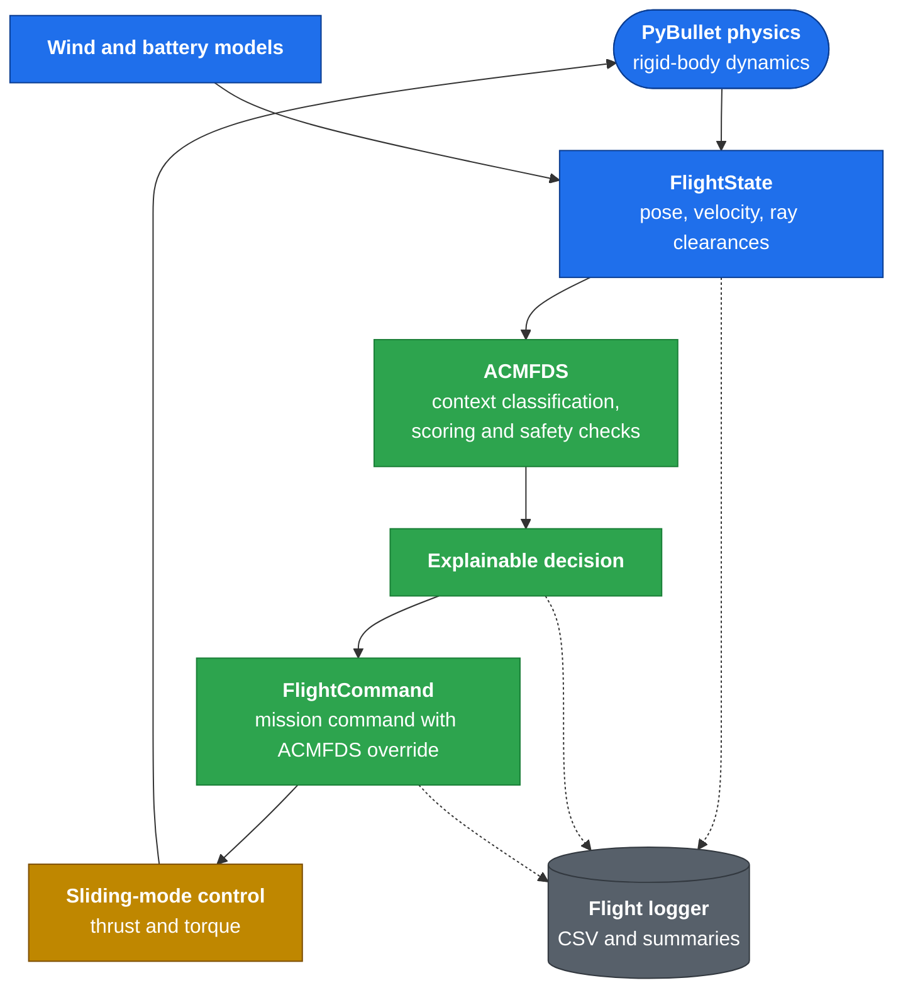
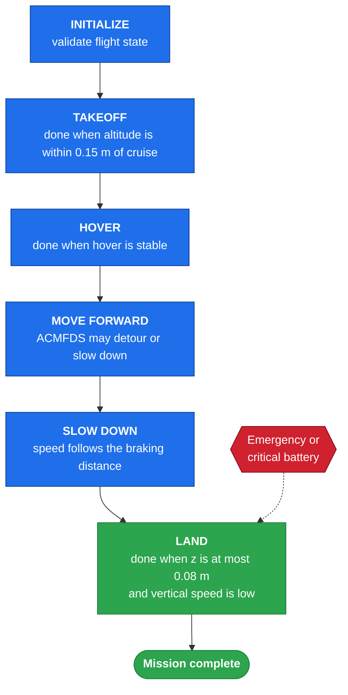
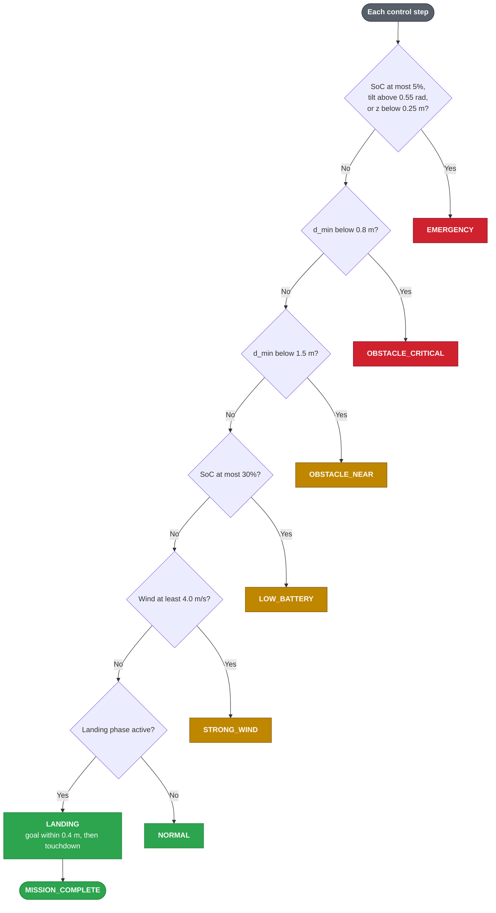
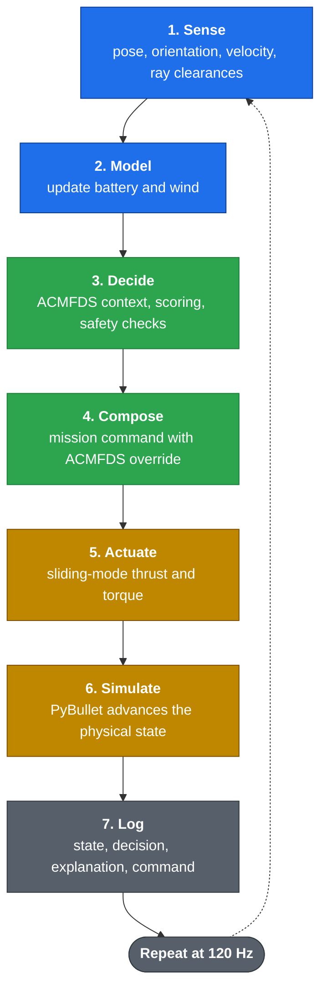
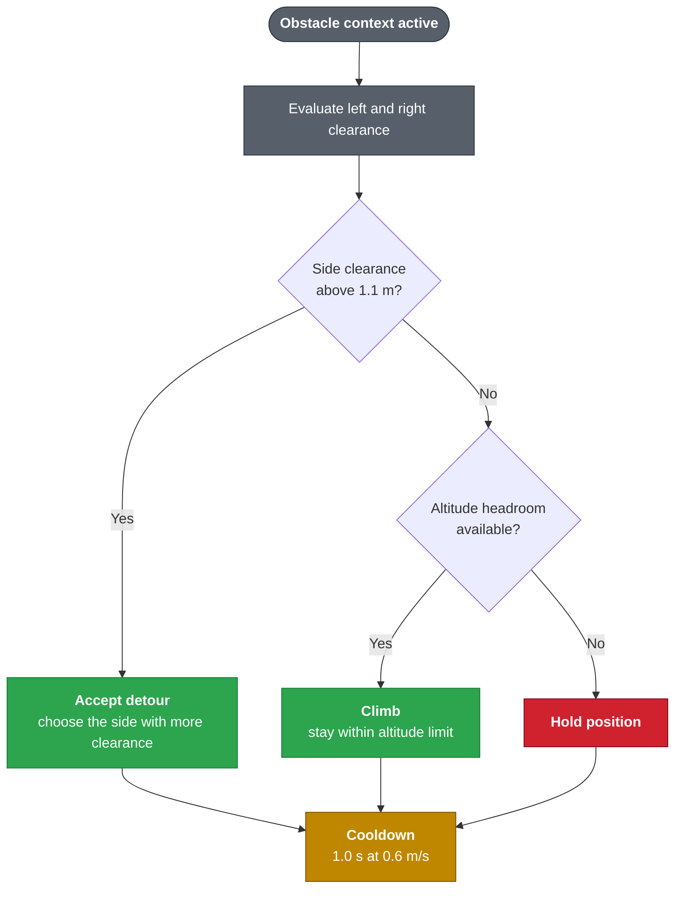
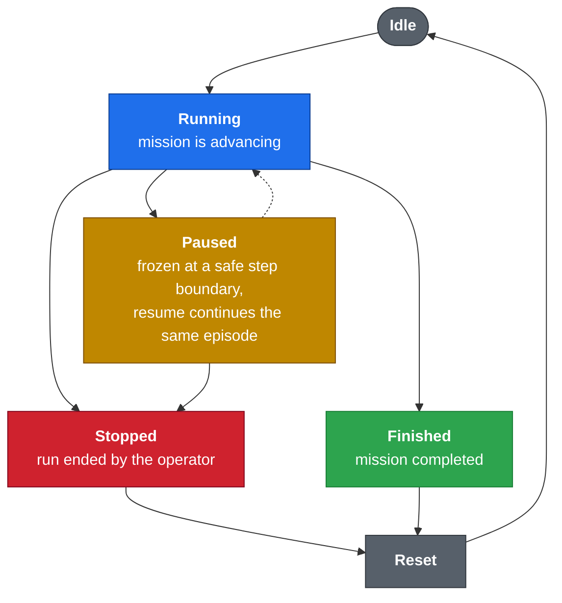

# Adaptive Multi-Objective Flight Decision Algorithm for Autonomous Quadcopters

A physics-based six-degree-of-freedom (6-DOF) quadcopter simulation built with **Python 3.10+ and PyBullet**. The project centers on ACMFDS, an explainable, rule-based, multi-objective flight decision system.

The system executes a complete simulated mission:

**INITIALIZE → TAKEOFF → HOVER → MOVE FORWARD → SLOW DOWN → LAND**

Flight behaviour is evaluated through rigid-body physics, feedback control, obstacle sensing, context-aware decisions, and per-step telemetry logging.

---

## 1. System Overview

The default mission combines PyBullet physics, a validated flight state, ACMFDS decisions, a sliding-mode actuation layer, and telemetry logging.

### 1.1 System Architecture



### 1.2 Mission State Flow

The mission sequencer moves through the phases below. Transitions are based on tolerances in the simulated state (see Section 7.4). ACMFDS can restrict or override the commanded motion inside any active phase.



### 1.3 ACMFDS Context State Flow

ACMFDS classifies the flight context every control step. Higher-priority safety conditions are evaluated first, so a low-battery drone still responds to a critical obstacle.



The order above is illustrative of the safety-first precedence. The exact order is defined in `decision/acmfds.py`.

### 1.4 Per-Control-Step Workflow

The simulation operates at a control frequency of **120 Hz**.



1. **Sense:** Read the drone's position, orientation, velocity, and forward-cone ray clearances from PyBullet.
2. **Model:** Update battery consumption and wind disturbances using the configured simulation models.
3. **Decide:** ACMFDS identifies the current flight context, applies objective weights and safety constraints, evaluates candidate actions, and generates an explainable decision.
4. **Compose:** The mission sequencer proposes a movement command. ACMFDS can override or restrict that command according to the active context and safety requirements.
5. **Actuate:** The sliding-mode control layer converts the selected command into normalized thrust and torque demands.
6. **Simulate:** PyBullet applies forces and torques to the rigid body and advances the physical state.
7. **Log:** Record the flight state, decision, explanation, candidate evaluations, commands, and performance metrics.

A decision such as `MOVE_FORWARD` is a high-level flight action, not a motor RPM. The decision-to-command mapping is implemented in `decision/acmfds.py`, while the actuation commands are executed by `controllers/actuation.py`.

### 1.5 Decision Priority

The system prioritizes objectives as follows:

**Collision safety → Energy conservation → Mission progress**

A low-battery drone must still respond to a critical obstacle. When available detour directions are blocked, the system can climb within its configured altitude limit or hold its position rather than automatically descending into an obstacle.

The actual action depends on the active context, sensor clearances, flight state, and implemented safety constraints.

---

## 2. Physics Fundamentals

The simulated quadcopter is represented as a rigid body. PyBullet computes its physical response to applied forces, torques, gravity, and disturbances.

### 2.1 Hover Thrust

For a drone with mass $m$, the thrust required to balance gravity during ideal hover is

$$
T_{\mathrm{hover}} = mg
$$

For the configured mass of $1.0\ \mathrm{kg}$ and gravitational acceleration of $9.81\ \mathrm{m/s^2}$,

$$
T_{\mathrm{hover}} = 1.0 \times 9.81 = 9.81\ \mathrm{N}
$$

The configured thrust interval is

$$
T \in [T_{\min},\ T_{\max}] = [0,\ 20]\ \mathrm{N}
$$

Hover thrust balances weight in the idealized vertical-force case. Wind, acceleration, attitude, and other disturbances can require additional control effort.

### 2.2 Mapping the Normalized Thrust Command to Force

The normalized thrust command is represented by

$$
u_T \in [-1,\ 1]
$$

The mapping is piecewise:

$$
T(u_T)=
\begin{cases}
T_{\mathrm{hover}} + u_T\,(T_{\max}-T_{\mathrm{hover}}), & u_T \geq 0 \\
T_{\mathrm{hover}} + u_T\,(T_{\mathrm{hover}}-T_{\min}), & u_T < 0
\end{cases}
$$

Using the configured values gives

$$
T(u_T)=
\begin{cases}
9.81 + 10.19\,u_T, & u_T \geq 0 \\
9.81 + 9.81\,u_T, & u_T < 0
\end{cases}
$$

Therefore,

$$
T(1)=20\ \mathrm{N}, \qquad T(0)=9.81\ \mathrm{N}, \qquad T(-1)=0\ \mathrm{N}
$$

The mapping is asymmetric around zero because the positive and negative command ranges cover different thrust intervals. The controller's thrust normalizer accounts for this piecewise mapping.

### 2.3 Linear and Angular Drag

The translational drag model is

$$
\mathbf{F}_{\mathrm{drag}} = -c_v\,\mathbf{v}
$$

where the configured linear drag coefficient is

$$
c_v = 0.25\ \mathrm{N\cdot s/m}
$$

The angular drag model is

$$
\boldsymbol{\tau}_{\mathrm{drag}} = -c_\omega\,\boldsymbol{\omega}
$$

where

$$
c_\omega = 0.15\ \mathrm{N\cdot m\cdot s}
$$

Here, $\mathbf{v}$ denotes linear velocity and $\boldsymbol{\omega}$ denotes angular velocity.

### 2.4 Translational and Rotational Dynamics

Newton's second law describes the translational response:

$$
\dot{\mathbf{v}} = \frac{\sum \mathbf{F}}{m}
$$

The rotational dynamics are represented as

$$
\dot{\boldsymbol{\omega}} = \mathbf{I}^{-1}\left(\sum \boldsymbol{\tau}\right)
$$

where $\mathbf{I}$ is the inertia tensor and $\sum\boldsymbol{\tau}$ represents the resulting torque under the implementation's rigid-body dynamics model.

PyBullet integrates the physical state at the simulation frequency of $120\ \mathrm{Hz}$. The project applies forces and torques to the simulated drone rather than teleporting it to desired positions.

### 2.5 Physical Parameters

| Parameter | Value |
|---|---:|
| Mass | $1.0\ \mathrm{kg}$ |
| $I_{xx}$ | $0.0230\ \mathrm{kg\cdot m^2}$ |
| $I_{yy}$ | $0.0230\ \mathrm{kg\cdot m^2}$ |
| $I_{zz}$ | $0.0417\ \mathrm{kg\cdot m^2}$ |
| Hover thrust | $9.81\ \mathrm{N}$ |
| Maximum thrust | $20\ \mathrm{N}$ |
| Simulation/control frequency | $120\ \mathrm{Hz}$ |
| Time step | $\Delta t = 1/120\ \mathrm{s} \approx 0.00833\ \mathrm{s}$ |

The inertia values are obtained from the simulated model through PyBullet.

---

## 3. Obstacle Sensing

The drone uses simulated ray tests to estimate front, left, and right clearances.

### 3.1 Converting Ray Results into Distance

A ray test provides a fractional hit position $f_i$. The corresponding clearance is

$$
d_i = f_i\,d_{\max}
$$

where the maximum sensing distance is

$$
d_{\max} = 5.0\ \mathrm{m}
$$

For the three directional readings,

$$
\begin{aligned}
d_{\mathrm{front}} &= f_{\mathrm{front}}\,d_{\max} \\
d_{\mathrm{left}}  &= f_{\mathrm{left}}\,d_{\max} \\
d_{\mathrm{right}} &= f_{\mathrm{right}}\,d_{\max}
\end{aligned}
$$

The minimum measured obstacle distance is

$$
d_{\min} = \min\left(d_{\mathrm{front}},\ d_{\mathrm{left}},\ d_{\mathrm{right}}\right)
$$

If a ray hits nothing within its sensing range, its fractional result is $f_i=1$. Its reported distance is therefore

$$
d_i = 1.0 \times 5.0 = 5.0\ \mathrm{m}
$$

A reading of exactly $5.00\ \mathrm{m}$ can consequently mean that no obstacle was detected within the sensing range. It is a capped measurement, not proof that the nearest obstacle is exactly five metres away.

### 3.2 Sensing Limitations

The three-ray forward cone provides directional clearance estimates. It does not provide complete omnidirectional obstacle detection or a global representation of the environment.

ACMFDS uses these sensor measurements to classify obstacle-related contexts and evaluate possible actions.

---

## 4. Sliding-Mode Control

The default actuation architecture uses **Sliding Mode Control (SMC)** to convert flight commands into physical control inputs.

SMC uses a sliding surface constructed from tracking error and error rate. A reaching law is then used to drive that surface toward zero.

### 4.1 Altitude Control

Let $z_{\mathrm{des}}$ be the desired altitude, $z$ be the actual altitude, and $v_z$ be vertical velocity.

The altitude tracking error is

$$
e_z = z_{\mathrm{des}} - z
$$

For a fixed altitude reference, its error rate is

$$
\dot e_z = -v_z
$$

The sliding surface is

$$
s_z = \dot e_z + \lambda_z\,e_z
$$

where

$$
\lambda_z = 2.2\ \mathrm{s^{-1}}
$$

The vertical acceleration command follows the configured reaching law:

$$
a_{\mathrm{cmd}} = \lambda_z\,\dot e_z + k_z\,\operatorname{sat}\left(\frac{s_z}{\phi_z}\right)
$$

with

$$
k_z = 3.0\ \mathrm{m/s^2}, \qquad \phi_z = 0.25\ \mathrm{m/s}
$$

The saturation function is

$$
\operatorname{sat}(x) = \operatorname{clip}(x,\ -1,\ 1)
$$

It limits the switching term within a boundary layer.

The commanded thrust is calculated from the vertical force requirement:

$$
T = m\,(g + a_{\mathrm{cmd}})
$$

The resulting thrust is constrained by the implementation's force limits and slew-rate protection.

### 4.2 Worked Altitude-Control Example

Consider

$$
e_z = 0.5\ \mathrm{m}, \qquad v_z = 0
$$

The error rate is

$$
\dot e_z = 0
$$

The sliding surface is

$$
s_z = 0 + 2.2\,(0.5) = 1.1\ \mathrm{m/s}
$$

The normalized surface value is

$$
\frac{s_z}{\phi_z} = \frac{1.1}{0.25} = 4.4
$$

Therefore,

$$
\operatorname{sat}(4.4) = 1
$$

The vertical acceleration command becomes

$$
a_{\mathrm{cmd}} = 2.2\,(0) + 3.0\,(1) = 3.0\ \mathrm{m/s^2}
$$

The corresponding thrust demand is

$$
T = m\,(g + a_{\mathrm{cmd}}) = 1.0\,(9.81 + 3.0) = 12.81\ \mathrm{N}
$$

Because this thrust is above hover thrust, its normalized command is obtained from the positive branch:

$$
u_T = \frac{T - T_{\mathrm{hover}}}{T_{\max} - T_{\mathrm{hover}}} = \frac{12.81 - 9.81}{20 - 9.81} \approx 0.294
$$

This example illustrates how altitude error becomes a sliding surface, then an acceleration command, then a physical thrust demand.

### 4.3 Sliding-Surface Interpretation

When the sliding surface approaches zero,

$$
s_z = \dot e_z + \lambda_z\,e_z \rightarrow 0
$$

On the ideal sliding surface,

$$
\dot e_z = -\lambda_z\,e_z
$$

The resulting error dynamics have the solution

$$
e_z(t) = e_z(0)\,e^{-\lambda_z t}
$$

For $\lambda_z = 2.2\ \mathrm{s^{-1}}$, the corresponding time constant is

$$
\tau_z = \frac{1}{\lambda_z} = \frac{1}{2.2} \approx 0.455\ \mathrm{s}
$$

This exponential relationship describes the ideal error behaviour once the system is on the sliding surface. It is not, by itself, proof that every real or simulated trajectory follows the ideal response exactly.

### 4.4 Thrust Slew-Rate Limit

The thrust change per control step is limited by

$$
\lvert T_k - T_{k-1} \rvert \leq R_T\,\Delta t
$$

where

$$
R_T = 90\ \mathrm{N/s}
$$

At $120\ \mathrm{Hz}$,

$$
\Delta t = \frac{1}{120}\ \mathrm{s}
$$

Therefore,

$$
R_T\,\Delta t = 90 \left(\frac{1}{120}\right) = 0.75\ \mathrm{N}
$$

The maximum permitted thrust change is thus $0.75\ \mathrm{N}$ per control step under this configured limit.

---

## 5. Horizontal Velocity Control and Tilt Generation

The horizontal control path maps desired motion into acceleration and attitude references.

### 5.1 Transforming Body-Frame Velocity into World Coordinates

Let:

- $v_{\mathrm{fwd}}$ be the forward velocity command.
- $v_{\mathrm{lat}}$ be the lateral velocity command.
- $\psi$ be the drone's yaw angle.

The desired world-frame velocity is

$$
v_{\mathrm{des},x} = \cos(\psi)\ v_{\mathrm{fwd}} - \sin(\psi)\ v_{\mathrm{lat}}
$$

$$
v_{\mathrm{des},y} = \sin(\psi)\ v_{\mathrm{fwd}} + \cos(\psi)\ v_{\mathrm{lat}}
$$

This rotation maps body-relative forward and lateral commands into the world coordinate frame.

### 5.2 Horizontal Acceleration Demand

The horizontal acceleration demand combines velocity-error feedback, feedforward compensation, and a wind-related correction:

$$
\mathbf{a}_{\mathrm{des}} = k_v\,(\mathbf{v}_{\mathrm{des}} - \mathbf{v}) + c_v\,\mathbf{v}_{\mathrm{des}} - a_{\mathrm{wind}}\,\hat{\mathbf{v}}_{\mathrm{rel}}
$$

The configured velocity-feedback gain is

$$
k_v = 3.2\ \mathrm{s^{-1}}
$$

Here:

- $\mathbf{v}_{\mathrm{des}}$ is desired horizontal velocity.
- $\mathbf{v}$ is the current horizontal velocity.
- $c_v\,\mathbf{v}_{\mathrm{des}}$ is the controller's feedforward compensation term.
- $a_{\mathrm{wind}}$ and $\hat{\mathbf{v}}_{\mathrm{rel}}$ describe the configured wind-related correction.

The coefficient names should be interpreted in the context of the corresponding control and physics modules.

### 5.3 Acceleration-to-Attitude Conversion

Let the desired horizontal acceleration components be $a_{\mathrm{des},x}$ and $a_{\mathrm{des},y}$.

The magnitude of the acceleration demand is

$$
\lVert \mathbf{a}_{\mathrm{des}} \rVert = \sqrt{a_{\mathrm{des},x}^{2} + a_{\mathrm{des},y}^{2}}
$$

The commanded tilt magnitude is

$$
\alpha = \min\left(\arctan\left(\frac{\lVert \mathbf{a}_{\mathrm{des}} \rVert}{g}\right),\ \alpha_{\max}\right)
$$

where the configured tilt limit is

$$
\alpha_{\max} = 0.36\ \mathrm{rad} \approx 20.6^\circ
$$

The world-frame direction of the desired acceleration is

$$
\beta = \operatorname{atan2}(a_{\mathrm{des},y},\ a_{\mathrm{des},x})
$$

The relative direction between the desired acceleration and the drone's yaw is

$$
\mathrm{rel} = \beta - \psi
$$

The desired pitch and roll references are

$$
\theta_{\mathrm{pitch,des}} = \alpha\cos(\mathrm{rel})
$$

$$
\theta_{\mathrm{roll,des}} = -\alpha\sin(\mathrm{rel})
$$

These references tilt the thrust direction to generate horizontal acceleration.

### 5.4 Maximum Horizontal Acceleration Estimate

Under the small-angle thrust-vectoring relationship used by the controller, the horizontal acceleration associated with a tilt angle $\alpha$ is approximately

$$
a_h = g\tan\alpha
$$

At the configured maximum tilt,

$$
\begin{aligned}
a_{h,\max} &= g\tan(\alpha_{\max}) \\
&= 9.81\tan(0.36) \\
&\approx 9.81\,(0.376) \\
&\approx 3.7\ \mathrm{m/s^2}
\end{aligned}
$$

For an idealized constant-deceleration estimate, stopping distance is

$$
d_{\mathrm{stop}} = \frac{v^2}{2a}
$$

At a speed of $v=1.2\ \mathrm{m/s}$ and an ideal braking acceleration of $a=3.7\ \mathrm{m/s^2}$,

$$
\begin{aligned}
d_{\mathrm{stop}} &= \frac{1.2^2}{2\,(3.7)} \\
&= \frac{1.44}{7.4} \\
&\approx 0.195\ \mathrm{m}
\end{aligned}
$$

This is an idealized kinematic estimate. Actual stopping distance and safe obstacle clearance depend on control response, sensing geometry, state, disturbance forces, and the time taken to recognize and respond to a hazard.

---

## 6. Attitude and Yaw Control

The attitude controller uses a sliding-surface structure for the rotational axes.

### 6.1 Attitude Error

For a desired attitude angle $\theta_{\mathrm{des}}$ and actual angle $\theta$,

$$
e_\theta = \theta_{\mathrm{des}} - \theta
$$

The angular-rate error is

$$
\dot e_\theta = \omega_{\mathrm{des}} - \omega
$$

The sliding surface is

$$
s_\theta = \dot e_\theta + \lambda_{\mathrm{att}}\,e_\theta
$$

where

$$
\lambda_{\mathrm{att}} = 6.0\ \mathrm{s^{-1}}
$$

The requested control torque is

$$
\tau = I_{\mathrm{axis}}\left[\lambda_{\mathrm{att}}\,\dot e_\theta + k_{\mathrm{att}}\operatorname{sat}\left(\frac{s_\theta}{\phi_{\mathrm{att}}}\right)\right]
$$

with the configured parameters

$$
k_{\mathrm{att}} = 40, \qquad \phi_{\mathrm{att}} = 0.30\ \mathrm{rad/s}
$$

Here $I_{\mathrm{axis}}$ is the moment of inertia associated with the controlled axis.

The normalized torque command is

$$
u_\tau = \operatorname{clip}\left(\frac{\tau}{\tau_{\max}},\ -1,\ 1\right)
$$

where

$$
\tau_{\max} = 1.5\ \mathrm{N\cdot m}
$$

### 6.2 Yaw-Angle Wrapping

Yaw is an angular quantity, so the raw difference between desired and actual yaw must be wrapped to the shortest signed angular difference.

Let

$$
\Delta\psi = \psi_{\mathrm{des}} - \psi
$$

The wrapped error is

$$
e_\psi = \operatorname{atan2}\left(\sin(\Delta\psi),\ \cos(\Delta\psi)\right)
$$

This gives an angular error in the interval

$$
e_\psi \in [-\pi,\ \pi]
$$

Angle wrapping prevents unnecessary long rotations. For example, a difference represented as $359^\circ$ can instead be interpreted as a shortest-direction error of approximately $-1^\circ$.

---

## 7. Mission Kinematics and Speed Planning

The mission sequencer adjusts horizontal speed according to remaining distance and configured acceleration and deceleration limits.

### 7.1 Braking Distance to the Goal

Let $d_{\mathrm{goal}}$ be the remaining distance to the target and $r_{\mathrm{reach}}$ be the goal-reach radius.

The braking distance used by the speed planner is

$$
d_{\mathrm{brake}} = \max\left(0,\ d_{\mathrm{goal}} - r_{\mathrm{reach}}\right)
$$

where

$$
r_{\mathrm{reach}} = 0.35\ \mathrm{m}
$$

### 7.2 Target Speed

The target speed is constrained by the cruise-speed limit, maximum speed, and stopping-distance requirement:

$$
v_{\mathrm{target}} = \min\left(v_{\mathrm{cruise}},\ v_{\max},\ \sqrt{2\,a_{\mathrm{decel}}\,d_{\mathrm{brake}}}\right)
$$

The configured values are

$$
v_{\mathrm{cruise}} = 1.2\ \mathrm{m/s}
$$

$$
v_{\max} = 1.5\ \mathrm{m/s}
$$

$$
a_{\mathrm{decel}} = 1.0\ \mathrm{m/s^2}
$$

The square-root term comes from the constant-acceleration kinematics equation

$$
v_f^2 = v_i^2 + 2a\,\Delta x
$$

By taking the final speed at the stopping point to be zero, the required relationship becomes

$$
v_{\mathrm{target}} = \sqrt{2\,a_{\mathrm{decel}}\,d_{\mathrm{brake}}}
$$

This is the speed that allows the drone to decelerate over the remaining braking distance under the assumed constant-deceleration model.

For example, when the braking distance is $0.85\ \mathrm{m}$,

$$
v_{\mathrm{target}} = \sqrt{2\,(1.0)\,(0.85)} \approx 1.30\ \mathrm{m/s}
$$

The configured cruise-speed limit reduces this command to at most $1.2\ \mathrm{m/s}$.

For a braking distance of $0.60\ \mathrm{m}$,

$$
v_{\mathrm{target}} = \sqrt{2\,(1.0)\,(0.60)} \approx 1.095\ \mathrm{m/s}
$$

### 7.3 Speed Slew Limiting

The commanded speed is adjusted gradually toward the target speed:

$$
v_{\mathrm{cmd},k} = v_{\mathrm{cmd},k-1} + \operatorname{clip}\left(v_{\mathrm{target}} - v_{\mathrm{cmd},k-1},\ -a_{\mathrm{limit}}\Delta t,\ a_{\mathrm{limit}}\Delta t\right)
$$

The configured limits are

$$
a_{\mathrm{accel}} = 0.7\ \mathrm{m/s^2}
$$

$$
a_{\mathrm{decel}} = 1.0\ \mathrm{m/s^2}
$$

The applicable rate limit depends on whether the drone is increasing or decreasing its speed.

The speed scaling factor is

$$
\mathrm{speed\_scale} = \frac{v_{\mathrm{cmd}}}{v_{\mathrm{cruise}}}
$$

### 7.4 Mission Phase Gates

Mission transitions are based on tolerances in the simulated state.

The takeoff-completion condition is

$$
\lvert z - z_{\mathrm{cruise}} \rvert \leq 0.15\ \mathrm{m}
$$

A landing-completion condition is

$$
z \leq 0.08\ \mathrm{m} \qquad \text{and} \qquad \lvert v_z \rvert < 0.15\ \mathrm{m/s}
$$

The heading controller is only commanded when the horizontal goal displacement is sufficiently large:

$$
\sqrt{\Delta x^2 + \Delta y^2} \geq 0.5\ \mathrm{m}
$$

This deadband prevents unnecessary heading changes when the drone is very close to its goal.

---

## 8. Environmental Models

The simulation includes modeled wind disturbances, battery consumption, and moving obstacles.

### 8.1 Wind Velocity Model

The modeled wind velocity is

$$
\mathbf{v}_w(t) = \hat{\mathbf{d}}\left[v_{\mathrm{base}} + A_g\sin\left(\frac{2\pi t}{T_g}\right) + \sigma_{\mathrm{turb}}\,J(t)\right]
$$

where:

- $\hat{\mathbf{d}}$ is the configured wind-direction unit vector.
- $v_{\mathrm{base}}$ is the base wind speed.
- $A_g$ is the gust amplitude.
- $T_g$ is the gust period.
- $\sigma_{\mathrm{turb}}$ scales the turbulence component.
- $J(t)$ is the deterministic turbulence function for a configured seed.

The turbulence function is

$$
J(t) = \frac{1}{4}\sum_{i=1}^{4}\sin(2\pi f_i t + \phi_i)
$$

The frequencies and phases are sampled using the seeded random-number generator:

$$
f_i \sim U(0.05,\ 0.4)
$$

$$
\phi_i \sim U(0,\ 2\pi)
$$

Here $U(a,b)$ denotes a uniform distribution on the interval $[a,b]$.

Once generated from a given seed, these parameters remain fixed for the run. This provides repeatable wind patterns for runs using the same seed and configuration.

### 8.2 Wind Force

The aerodynamic wind-force model depends on the relative air velocity between the wind and the drone.

Define

$$
\mathbf{v}_{\mathrm{rel}} = \mathbf{v}_w - \mathbf{v}_{\mathrm{drone}}
$$

Its magnitude is

$$
v_{\mathrm{rel}} = \lVert \mathbf{v}_{\mathrm{rel}} \rVert
$$

The modeled force is

$$
\mathbf{F}_{\mathrm{wind}} = \frac{1}{2}\,\rho\,C_d\,A\,v_{\mathrm{rel}}^2\,\hat{\mathbf{v}}_{\mathrm{rel}}
$$

where

$$
\rho = 1.225\ \mathrm{kg/m^3}, \qquad C_d = 1.0, \qquad A = 0.09\ \mathrm{m^2}
$$

The combined coefficient is

$$
\frac{1}{2}\,\rho\,C_d\,A = \frac{1}{2}\,(1.225)(1.0)(0.09) = 0.055125
$$

Therefore, the force magnitude can be written as

$$
F_{\mathrm{wind}} \approx 0.0551\,v_{\mathrm{rel}}^2\ \mathrm{N}
$$

At a relative airspeed of $4.5\ \mathrm{m/s}$,

$$
\begin{aligned}
F_{\mathrm{wind}} &\approx 0.0551\,(4.5)^2 \\
&= 0.0551\,(20.25) \\
&\approx 1.12\ \mathrm{N}
\end{aligned}
$$

For a $1.0\ \mathrm{kg}$ drone, this force corresponds to an acceleration magnitude of approximately

$$
a_{\mathrm{wind}} = \frac{F_{\mathrm{wind}}}{m} \approx 1.12\ \mathrm{m/s^2}
$$

This estimate illustrates the scale of the modeled disturbance. The actual acceleration depends on the drone's relative airspeed and the direction of the wind force.

The strong-wind scenario uses a base crosswind of $4.5\ \mathrm{m/s}$. The configured ACMFDS strong-wind threshold is $4.0\ \mathrm{m/s}$.

### 8.3 Battery-Energy Model

The model estimates power consumption as a function of normalized thrust.

The thrust fraction is

$$
p = \frac{T}{T_{\max}}
$$

With $T_{\max}=20\ \mathrm{N}$,

$$
p = \frac{T}{20}, \qquad p \in [0,\ 1]
$$

Power consumption is modeled as

$$
P(p) = P_{\mathrm{base}} + P_{\mathrm{thrust}}\,p^{1.5}
$$

where

$$
P_{\mathrm{base}} = 15\ \mathrm{W}, \qquad P_{\mathrm{thrust}} = 85\ \mathrm{W}
$$

Thus,

$$
P(p) = 15 + 85\,p^{1.5}\ \mathrm{W}
$$

For a simulation step lasting $\Delta t$ seconds, the energy consumed in watt-hours is

$$
\Delta E = P(p)\,\frac{\Delta t}{3600}
$$

The division by $3600$ converts watt-seconds into watt-hours.

The remaining energy is updated as

$$
E_{k+1} = \max\left(0,\ E_k - P(p)\,\frac{\Delta t}{3600}\right)
$$

For the configured battery capacity of $4.0\ \mathrm{Wh}$, state of charge is

$$
\mathrm{SoC} = 100\,\frac{E_{\mathrm{remaining}}}{4.0\ \mathrm{Wh}}
$$

### 8.4 Battery Worked Example: Hover

During idealized hover, the thrust fraction is

$$
p = \frac{9.81}{20} = 0.4905
$$

Its power-law term is approximately

$$
p^{1.5} \approx 0.3436
$$

Power consumption is therefore

$$
\begin{aligned}
P &= 15 + 85\,(0.3436) \\
&\approx 44.2\ \mathrm{W}
\end{aligned}
$$

The energy consumption per second is approximately

$$
\frac{44.2}{3600} \approx 0.01228\ \mathrm{Wh/s}
$$

For a $4.0\ \mathrm{Wh}$ battery, this corresponds to a state-of-charge reduction of

$$
\begin{aligned}
r_{\mathrm{SoC}} &= \frac{0.01228}{4.0} \times 100 \\
&\approx 0.307\ \%/\mathrm{s}
\end{aligned}
$$

Over $21.6\ \mathrm{s}$, the estimated reduction is

$$
\begin{aligned}
\Delta\mathrm{SoC} &\approx 0.307 \times 21.6 \\
&\approx 6.63\ \%
\end{aligned}
$$

This estimate is consistent with a logged reduction of approximately $6.66\%$ for the referenced run, subject to the actual thrust history and simulation conditions.

At a constant modeled power demand of $100\ \mathrm{W}$, the nominal energy-to-power ratio is

$$
t = \frac{E}{P} = \frac{4.0\ \mathrm{Wh}}{100\ \mathrm{W}} = 0.04\ \mathrm{h} = 144\ \mathrm{s}
$$

This is an idealized duration at a constant $100\ \mathrm{W}$ demand, not a general guarantee of flight time.

The configured battery thresholds are:

| Threshold | State of charge |
|---|---:|
| Low battery | 30% |
| Critical battery | 15% |
| Emergency battery | 5% |

### 8.5 Moving-Obstacle Trajectories

Moving obstacles follow deterministic sinusoidal trajectories.

Their position is

$$
\mathbf{p}(t) = \mathbf{c} + \mathbf{a}\,A\sin\left(\frac{2\pi t}{T} + \phi\right)
$$

where:

- $\mathbf{c}$ is the center position.
- $\mathbf{a}$ is the movement-axis unit vector.
- $A$ is the motion amplitude.
- $T$ is the motion period.
- $\phi$ is the phase offset.

The configured example uses

$$
A = 2\ \mathrm{m}, \qquad T = 8\ \mathrm{s}
$$

Differentiating the position gives the analytic velocity:

$$
\mathbf{v}(t) = \mathbf{a}\,A\,\frac{2\pi}{T}\cos\left(\frac{2\pi t}{T} + \phi\right)
$$

The maximum speed is

$$
\begin{aligned}
v_{\max} &= A\,\frac{2\pi}{T} \\
&= 2\cdot\frac{2\pi}{8} \\
&\approx 1.57\ \mathrm{m/s}
\end{aligned}
$$

Because the trajectory is defined analytically and its parameters remain fixed, the motion is reproducible for a given configuration and seed.

The moving obstacles are kinematic objects whose positions are updated during the simulation. They are not pushed by the drone.

---

## 9. ACMFDS Decision Logic

ACMFDS evaluates flight context and selects actions using safety constraints and context-dependent objective weights.

### 9.1 Multi-Objective Evaluation

The four objectives are:

| Objective | Purpose |
|---|---|
| `SAFETY` | Maintain safety-related limits and respond to critical conditions |
| `ENERGY_EFFICIENCY` | Moderate motion according to available battery energy |
| `OBSTACLE_CLEARANCE` | Evaluate obstacle proximity and detour options |
| `MISSION_PROGRESS` | Encourage movement toward the configured destination |

For explanatory purposes, the context-dependent weight vector can be represented as

$$
\mathbf{w} = \begin{bmatrix} w_{\mathrm{safety}} & w_{\mathrm{energy}} & w_{\mathrm{clearance}} & w_{\mathrm{progress}} \end{bmatrix}
$$

The weights satisfy

$$
w_{\mathrm{safety}} + w_{\mathrm{energy}} + w_{\mathrm{clearance}} + w_{\mathrm{progress}} = 1
$$

For example, the configured illustrative objective weights include:

| Context | Safety | Energy | Clearance | Progress |
|---|---:|---:|---:|---:|
| `NORMAL` | 0.25 | 0.20 | 0.20 | 0.35 |
| `EMERGENCY` | 0.75 | 0.10 | 0.10 | 0.05 |

The `EMERGENCY` weight vector assigns the largest weight to safety and only 0.05 to mission progress.

These weights help explain how ACMFDS changes priorities across contexts. They do not replace the explicit feasibility checks and safety rules implemented in the decision logic.

### 9.2 Obstacle Context Classification

The minimum forward-cone clearance is

$$
d_{\min} = \min\left(d_{\mathrm{front}},\ d_{\mathrm{left}},\ d_{\mathrm{right}}\right)
$$

The configured obstacle thresholds are:

| Condition | Result |
|---|---|
| $d_{\min} < 0.8\ \mathrm{m}$ | `OBSTACLE_CRITICAL` |
| $d_{\min} < 1.5\ \mathrm{m}$ | `OBSTACLE_NEAR` |
| $d_{\min} < 2.0\ \mathrm{m}$ | obstacle caution |

The implemented context checks use precedence rules so that higher-priority safety conditions are handled before less critical objectives.

### 9.3 Other Context Thresholds

The configured emergency conditions include

$$
\mathrm{SoC} \leq 5\%
$$

or

$$
\lvert \mathrm{tilt} \rvert > 0.55\ \mathrm{rad}
$$

or

$$
z < 0.25\ \mathrm{m}
$$

The configured low-battery condition is

$$
\mathrm{SoC} \leq 30\%
$$

The strong-wind condition is

$$
\lVert \mathbf{v}_w \rVert \geq 4.0\ \mathrm{m/s}
$$

Goal proximity is also used in landing and mission-completion handling, with a configured proximity threshold of approximately

$$
d_{\mathrm{goal}} \leq 0.4\ \mathrm{m}
$$

The precise action depends on context precedence, the current state, and the relevant safety checks.

The documented ACMFDS contexts include:

- `NORMAL`
- `OBSTACLE_NEAR`
- `OBSTACLE_CRITICAL`
- `LOW_BATTERY`
- `STRONG_WIND`
- `LANDING`
- `EMERGENCY`
- `MISSION_COMPLETE`

### 9.4 Detour Acceptance

A detour direction must satisfy the configured clearance gate:

$$
d_{\mathrm{side}} > d_{\mathrm{critical}} + d_{\mathrm{safety\ margin}}
$$

For the configured values,

$$
d_{\mathrm{critical}} = 0.8\ \mathrm{m}
$$

$$
d_{\mathrm{safety\ margin}} = 0.3\ \mathrm{m}
$$

so

$$
d_{\mathrm{gate}} = 0.8 + 0.3 = 1.1\ \mathrm{m}
$$

A candidate side must therefore provide a clearance greater than $1.1\ \mathrm{m}$ to pass this detour acceptance check.



### 9.5 Maneuver Cooldown

After an obstacle maneuver, the configured cooldown is

$$
t_{\mathrm{cooldown}} = 1.0\ \mathrm{s}
$$

During this period, the cautious-speed setting is

$$
v_{\mathrm{cautious}} = 0.6\ \mathrm{m/s}
$$

This allows cautious motion to be maintained when rotating the drone can change the orientation of its body-frame sensing rays.

The maneuver tracker distinguishes issuing an avoidance decision from verifying that the obstacle has actually been cleared. A decision is not automatically treated as proof of a successful maneuver.

### 9.6 Explainable Decisions

A decision can include:

- The current context and chosen action.
- The measured values that triggered the action.
- Active safety constraints.
- Candidate directions and their clearance results.
- The selected direction and movement command.
- The reason for accepting or rejecting candidate actions.
- The resulting command sent to the actuation layer.

These outputs can be inspected through the live dashboard and per-step CSV logs.

---

## 10. GPS Coordinate Mapping

The simulated GPS feature converts local PyBullet coordinates into approximate geographic coordinates around a configurable reference origin.

The reference origin $(\mathrm{lat}_0,\ \mathrm{lon}_0)$ corresponds to local world position

$$
(X,\ Y) = (0,\ 0)
$$

The mapping uses a local flat-Earth approximation.

### 10.1 Latitude Conversion

The approximate latitude is

$$
\mathrm{lat} = \mathrm{lat}_0 + \frac{y}{111320}
$$

Here $y$ is the northward displacement in metres, and latitude is expressed in degrees.

### 10.2 Longitude Conversion

The approximate longitude is

$$
\mathrm{lon} = \mathrm{lon}_0 + \frac{x}{111320\,\cos(\phi_0)}
$$

where $\phi_0$ is the reference latitude expressed in radians when evaluated by the cosine function.

The cosine term accounts for the fact that the ground distance represented by one degree of longitude decreases with latitude.

### 10.3 Example

For a reference latitude of

$$
\mathrm{lat}_0 = 47.3769^\circ
$$

the cosine factor is approximately

$$
\cos(47.3769^\circ) \approx 0.6773
$$

The approximate distance per degree of longitude is

$$
111320 \times 0.6773 \approx 75393\ \mathrm{m/degree}
$$

If the drone starts at

$$
x = -4\ \mathrm{m}, \qquad y = 0\ \mathrm{m}
$$

its latitude remains approximately equal to the reference latitude:

$$
\mathrm{lat} \approx \mathrm{lat}_0
$$

Its longitude displacement is

$$
\begin{aligned}
\Delta\mathrm{lon} &= \frac{-4}{75393} \\
&\approx -5.31 \times 10^{-5}\ ^\circ
\end{aligned}
$$

This maps the simulated start to a point approximately four metres west of the reference origin.

### 10.4 GPS Limitations

This feature visualizes approximate geographic coordinates derived from simulated PyBullet positions. It is not a physical GPS receiver, and it does not provide a real-world obstacle map.

The flat-Earth approximation is suitable for the small distances used in the described scenarios. It is not intended for continental-scale navigation, where a full geodetic method would be necessary.

Optional browser geolocation represents the operator's device location. It is distinct from the simulated drone position and must not be presented as real drone GPS telemetry.

The GPS display does not change the local navigation goal or ACMFDS flight decisions in the described implementation. GPS waypoint navigation is not implemented in this revision.

---

## 11. Installation

Python 3.10 or later is recommended. The project has been developed and tested on Python 3.13.

Install the project dependencies:

```bash
pip install -r requirements.txt
```

Core dependencies include PyBullet, NumPy, scikit-learn, joblib, FastAPI, Uvicorn, and WebSockets, as specified by the project requirements.

---

## 12. Running the Project

### Standard Simulation

```bash
python main.py
```

### Headless Simulation

```bash
python main.py --headless
```

### Individual Scenarios

```bash
python main.py --scenario obstacle
python main.py --scenario low-battery
python main.py --scenario strong-wind
python main.py --scenario combined
python main.py --scenario moving-obstacles
python main.py --list-scenarios
```

### Multiple Episodes

```bash
python main.py --headless --episodes 3 --seed 7 --output results/run.csv
```

### Evaluate Multiple Runs

```bash
python evaluate.py --scenario obstacle --episodes 5
```

### Manual Keyboard Mode

```bash
python main.py --mode manual
```

Manual keyboard control is a legacy mode.

### Integrated Dashboard

Start the dashboard server:

```bash
python -m dashboard.server
```

Then open:

http://127.0.0.1:8000

On Windows, use the Python executable from the configured project environment if necessary. For example:

```cmd
"C:\Users\jovika\anaconda3\envs\pybullet\python.exe" -m dashboard.server
```

To display the native PyBullet window for the same flight, enable **Native PyBullet window** in Run Control before starting the mission.

---

## 13. Live Dashboard

The dashboard is implemented using FastAPI, WebSockets, HTML, CSS, and JavaScript.

### Single Authoritative Simulation

The PyBullet mission runs on the server. The browser receives telemetry snapshots from that simulation. Refreshing the browser does not advance the physics simulation, and duplicate mission starts are rejected while a flight is active.

### Synchronized Outputs

The native PyBullet window, browser visualization, telemetry charts, and CSV log use data from the same flight.

### 3D Visualization

The browser displays the logged drone pose and obstacle geometry. Moving obstacles use positions from simulation records. The browser view is a visualization, not an independent physics engine.

### Telemetry and Graphs

The dashboard displays measurements and simulation values such as:

- Current and target altitude.
- Position and flight trajectory.
- Horizontal and vertical velocity.
- Obstacle distance and directional clearance.
- Wind speed and direction.
- Battery percentage.
- Current ACMFDS context and decision timeline.
- Mission phase and elapsed time.

### Explainable Decision Panel

The dashboard shows the ACMFDS context, selected action, decision explanation, candidate clearances, accepted or rejected candidate verdicts, movement action, and executed command.

### Mission Controls

The dashboard provides mission controls for starting, pausing, resuming, stopping, and resetting the simulation. Pause freezes the simulation at a safe step boundary, while resume continues the same episode. Stop is distinct from pause.



### Validated Configuration

The server validates supported settings such as scenario selection, target altitude, goal coordinates, cruise speed, initial battery charge, wind configuration, and moving-obstacle settings.

### Flight Logs

Each run writes per-step CSV data, typically to a location such as

```text
results/acmfds_log_<scenario>_<episode>.csv
```

The logs can contain:

- Position, altitude, velocity, and orientation.
- Mission phase and goal distance.
- Obstacle distance and directional clearances.
- Battery and wind values.
- ACMFDS context, decision, and explanation.
- Candidate evaluations and selected direction.
- Movement action and executed command.
- Thrust, collisions, and mission status.

The summary reports mission outcome, duration, minimum obstacle distance, altitude errors, battery consumption, decision distribution, and emergency or safe-landing counts.

---

## 14. Automated Testing

Run the test suite with:

```bash
python test_env.py
```

The test suite covers areas including:

- Gymnasium API compliance and reset/step contracts.
- Drone physics and hover behaviour.
- `FlightState` validation and per-field source tags.
- ACMFDS decision rules and explainable outputs.
- Battery bounds and workload-based consumption.
- Wind reproducibility and drag-force calculations.
- Mission phase progression.
- Decision-to-command mapping and actuation limits.
- Ray sensing against known obstacle geometry.
- Orientation-transformed visual-part positions.
- Per-step CSV logging.
- Reproducibility of moving obstacles.
- Dashboard API validation.
- Simulated GPS conversion and origin gating.
- Telemetry integrity and decision explanations.
- Obstacle-clearance margins and event counting.
- Speed-planning limits and braking behaviour.
- Pause/resume semantics and battery-model consistency.

Always run the current `test_env.py` before reporting the final test count. Report the test count and result printed by the exact project revision being evaluated.

---

## 15. Reproducible Test Scenarios

The project contains six configured scenarios. Each scenario defines its environment and initial conditions while ACMFDS uses its configured decision thresholds.

| Scenario | Conditions | Purpose |
|---|---|---|
| A: `normal` | Low wind, adequate battery, no obstacle directly blocking the planned route | Demonstrate the complete mission sequence |
| B: `obstacle` | Two static pillars near the planned route | Test sensing and obstacle avoidance |
| C: `low-battery` | Initial battery charge of 32%, with a side obstacle | Evaluate energy conservation and safe landing |
| D: `strong-wind` | 4.5 m/s base crosswind, gusts, and a downwind obstacle | Evaluate the response to wind disturbances |
| E: `combined` | 28% initial charge, an obstacle, and active wind | Evaluate safety priority under competing conditions |
| F: `moving-obstacles` | Two static pillars and two moving obstacles | Evaluate dynamic obstacle avoidance |

The standard start position is

$$
(X_s,\ Y_s) = (-4.0,\ 0.0)\ \mathrm{m}
$$

The default target position is

$$
(X_g,\ Y_g) = (4.5,\ 0.0)\ \mathrm{m}
$$

The default cruise altitude is

$$
z_{\mathrm{cruise}} = 2.0\ \mathrm{m}
$$

The initial horizontal goal distance is

$$
\begin{aligned}
d &= \sqrt{(X_g - X_s)^2 + (Y_g - Y_s)^2} \\
&= \sqrt{(4.5 - (-4.0))^2 + (0.0 - 0.0)^2} \\
&= 8.5\ \mathrm{m}
\end{aligned}
$$

The scenarios vary the environment and initial conditions rather than deliberately changing ACMFDS thresholds between tests.

---

## 16. Reported Headless Scenario Results

The supplied project report records headless runs using seed `123`.

| Scenario | Outcome | Duration | Collisions | Minimum obstacle distance |
|---|---|---:|---:|---:|
| Normal | Landed | 16.3 s | 0 | 5.0 m |
| Obstacle | Landed | 27.3 s | 0 | 0.56 m |
| Low-battery | Landed | 25.3 s | 0 | 1.19 m |
| Strong-wind | Landed | 20.6 s | 0 | 0.95 m |
| Combined | Landed | 30.0 s | 0 | 0.80 m |
| Moving-obstacles | Landed | 21.6 s | 0 | 0.77 m |

These results are observations from the specified runs, not universal safety guarantees. Re-run the scenarios before publication if you need to claim that the results were reproduced on the current revision.

Example reproduction command:

```bash
python main.py --headless --scenario obstacle --seed 123
```

The project also reports a dashboard synchronization test in which browser telemetry and CSV records matched for the same episode. Report this as verified only for the run actually checked.

---

## 17. Limitations and Engineering Notes

### Reactive Obstacle Avoidance

Obstacle avoidance is reactive and depends on forward-cone ray measurements. There is no global path planner in the described default decision path. A detour can pass close to a secondary obstacle even if no collision occurs.

### Limited Sensing Field

The three-ray forward cone does not provide complete omnidirectional obstacle detection. It cannot guarantee detection of every obstacle behind, above, or outside its sensing directions.

### Simplified Wind Model

The wind model uses assumed parameters such as air density, drag coefficient, and exposed area. It creates modeled disturbances rather than calibrated measurements of real aerodynamic behaviour. Gusts can produce transient tracking errors.

### Landing and Ground Effect

Ground effect is not modeled. The landing gate is a control-side protection that reduces horizontal demand near touchdown. It is not a complete aerodynamic ground-effect model.

### Moving Obstacles

Moving obstacles are kinematic bodies following deterministic sinusoidal trajectories. They move through the simulation but are not pushed by the drone.

### Simulated GPS

The geographic map converts simulated world coordinates into approximate latitude and longitude around a configurable geographic origin. It uses a local flat-Earth approximation suited to the short distances used in these scenarios.

The reference origin corresponds to local world position $(X,Y)=(0,0)$. The default drone start at $(-4,0)$ is four metres west of that origin.

The mapping is derived from logged PyBullet positions. It is not a real GPS receiver or a real-world obstacle map.

Browser geolocation is optional and represents the operator's device location. It is distinct from simulated drone position. No physical drone GPS telemetry source is connected.

GPS waypoint navigation is not implemented in the described revision. The simulated GPS map is a display and verification feature. The navigation goal remains in local world coordinates, and ACMFDS decisions are unchanged by the geographic origin.

### Safety Claims

Zero recorded collisions in a scenario means no collisions were recorded during that particular run. It does not prove safety under every obstacle layout, wind condition, initial state, or real-world flight condition.

---

## 18. Project Structure

```text
drone_simulation_project/
├── main.py
├── legacy_modes.py
├── evaluate.py
├── scenarios.py
├── README.md
├── requirements.txt
│
├── state/
│   └── flight_state.py
│
├── decision/
│   └── acmfds.py
│
├── controllers/
│   └── actuation.py
│
├── simulation/
│   ├── acmfds_mission.py
│   ├── mission.py
│   ├── pybullet_sim.py
│   ├── drone.py
│   ├── obstacles.py
│   ├── battery.py
│   └── wind.py
│
├── telemetry/
│   ├── gps.py
│   └── logger.py
│
├── dashboard/
│   ├── server.py
│   └── static/
│       ├── index.html
│       ├── app.js
│       └── style.css
│
├── trajectory/
│   └── interpolation.py
│
├── results/
│   └── acmfds_log_<scenario>_<episode>.csv
│
└── test_env.py
```

The exact files present may vary by repository revision. Verify the folder structure against the project before submission.

---

## 19. Project Contribution

The project's central contribution is an **explainable, multi-objective flight-decision system operating over a physics-based quadcopter simulation**.

The system combines:

- Rigid-body flight simulation using PyBullet.
- Context-aware flight decisions through ACMFDS.
- Multi-objective prioritization of safety, energy efficiency, clearance, and mission progress.
- Sliding-mode thrust, attitude, and velocity actuation.
- Reactive obstacle sensing and candidate-direction evaluation.
- Modeled wind and battery disturbances.
- Deterministic moving-obstacle scenarios.
- A live dashboard for telemetry visualization and mission controls.
- Per-step CSV logging and reproducible scenario evaluation.

The dashboard makes the relationship between sensed conditions, ACMFDS decisions, executed commands, and resulting flight behaviour observable. Logged simulation runs support performance analysis while the documented limitations distinguish simulation results from guarantees of real-world flight safety.

---

